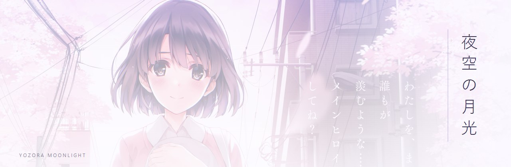

  <picture>
    <source media="(prefers-color-scheme: dark)" srcset="./assets/hero.jpg">
    
  </picture>

<h1 align="center">YozoraMoonlight</h1>

  
  
思いついたら、つくる。 

## About me

I enjoy seeing an idea turn into a working system.

I'm naturally drawn to web applications, management systems, and small personal projects. Sometimes I come up with something of my own; other times, I find an existing system worth recreating or improving.

A lot of my interest goes into imagining how things should work. How different features fit together, how someone moves through a system, how interactions feel, and how the interface brings everything together.

I usually start by picturing what I want to build, then work out how to make it happen. I spend time thinking about the features, interactions, and overall experience before bringing it to life.

Making systems and repositories has slowly become one of my hobbies. Some projects start as personal ideas, others are experiments or attempts to recreate and improve something that already exists.

Not everything I make needs to become something big or serve a particular purpose. Sometimes, I just enjoy making things because I want to see them exist.

The rest of the time I'm watching anime or reading about Japan. I'd like to live there eventually.

## Currently

- **· Building** — small projects that outgrow their original scope
- **· Exploring** — new tools, side experiments, how things fit together
- **· Thinking about** — how a system should work, and why one flow feels better than another
- **· Off the clock** — anime, Japanese culture, and a long-term plan to live in Japan

## Things I created

<blockquote>
  <h3>iStudent LMS</h3>
 · Born from a simple idea: replacing the paper sheets grade our IT teacher used to track classroom activities and grades.
  
A learning management system for students.

  
<kbd>web app</kbd>&nbsp; <kbd>coursework</kbd>

</blockquote>

<blockquote>
  <h3>Gakusei</h3>
  · eLMS companion app
  
A mobile companion that brings courses and assignments into a more focused, accessible experience

  
<kbd>mobile app</kbd>&nbsp; <kbd>education</kbd>

</blockquote>

<blockquote>
  <h3>PageWatch</h3>
  · website management portal
  
A website care portal where clients request changes and follow their site's progress while the studio manages the work.

  
<kbd>web app</kbd>&nbsp; <kbd>client portal</kbd>

</blockquote>

<!--
  hello lol
-->

  Banner artwork © its respective rights holders — here out of admiration, not ownership.
    
  

